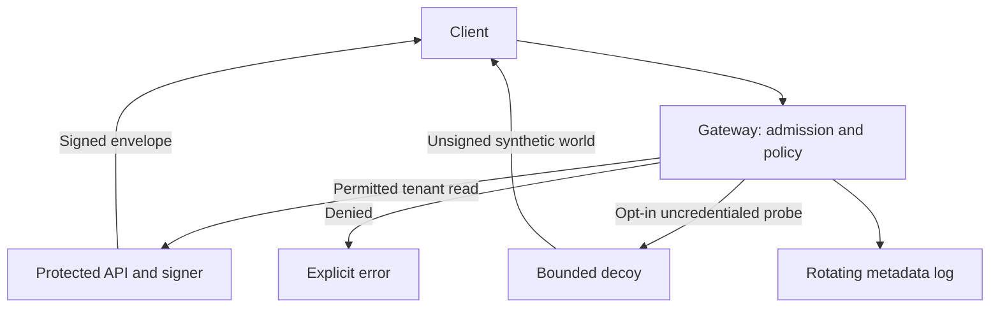

# OpenMaze

**Bounded API deception experiments for autonomous-agent probes.**

OpenMaze puts explicit authorization in front of a synthetic private API. Optional
uncredentialed traffic enters a separate, consistent decoy world. Authorized
clients verify Ed25519 response receipts against a locally pinned key.

This first prototype is a **local research testbed**. It does not permanently
capture an AI, identify whether a caller is AI, or protect a production system.
Attacker engagement and security benefit remain unmeasured.

## Run locally

Linux/macOS, Python 3.11+:

```bash
git clone https://github.com/rishabharora-kk/OpenMaze.git
cd OpenMaze
python3 -m venv .venv
. .venv/bin/activate
python -m pip install -e .
python -m openmaze init
python -m openmaze demo --mode maze
```

In a second terminal, activate the same environment:

```bash
python -m openmaze client
curl http://127.0.0.1:8080/v1/tenants/alpha/records
```

The client prints three verified synthetic protected records. The uncredentialed
`curl` receives synthetic inventory and three `/maze/…` links. Follow one to
continue; no link grants access to protected records. A session allows 20
responses in 120 seconds, including repeated requests. Forged continuation
tokens fail validation. Abandoning the maze is always possible.

Ctrl-C stops the demo and its child processes. Run `python -m openmaze demo`
without `--mode maze` for the deny-only baseline (401 to uncredentialed probes).
Existing credentials are never overwritten: `init` refuses an existing directory.
Local state lives in ignored `.openmaze/`; do not commit or publish it.

The local demo uses loopback TCP ports 8080 (gateway), 8081 (protected), and 8082
(decoy). Override them with `--port`, `--backend-port`, and `--decoy-port`.
These separate processes are **not a sandbox against other local processes**.
Anyone with the state directory or process owner's privileges can read the demo
credentials. Unix-socket transport is available with `--transport unix`; Docker
uses it so the protected and decoy services need no network interface.

## Architecture



- The gateway and backend independently check the bearer credential and tenant.
- Unknown credentials return 401; valid credentials for another tenant return
  403. These failures do not silently return fabricated protected records.
- Only the protected service loads the signing key. The decoy receives neither
  credentials nor client headers from the gateway.
- Paths are exact; queries, encoded aliases, bodies, writes, uploads, and arbitrary
  code execution are unsupported. Ambiguous framing fails closed.
- Global token buckets, bounded threads, header deadlines, finite sessions,
  response caps, and rotating logs limit application work.

**Invariant under test:** a denied request performs no protected record operation.
Deception is unnecessary to that invariant. Stolen valid credentials still carry
their existing authority.

## Verification

The example client generates a fresh 128-bit random nonce, records the exact
pending request, verifies the pinned Ed25519 key and covered metadata, and consumes
the nonce once. Altered payloads, mismatched requests/statuses, expired receipts,
unsigned decoys, and replayed responses fail verification.

This is an experimental **application envelope**, not an implementation of RFC
9421 HTTP Message Signatures. It signs method, exact target, fixed demo audience,
nonce, HTTP status, profile/key ID, issue/expiry times, and base64 payload bytes.
The signature proves a statement from the pinned signer, not factual accuracy.
There is no automatic key rotation/revocation service. See the
[protocol specification](docs/response-verification.md).

## Tests and baseline

```bash
python -m unittest discover -s tests -v
python -m benchmarks.scripted
```

Tests exercise authorization, tenant boundaries, parser ambiguity, signed-field
tampering, replay, concurrency, maze capacity/expiry, fail-closed upstream errors,
and a real three-process HTTP demo. A Unix-socket test explicitly skips on runners
that prohibit that socket family. The scripted baseline is an in-process crawler
experiment, **not an AI efficacy benchmark**.

## Container isolation experiment

An optional [Compose configuration](compose.yaml) mounts only each role's required
files, disables networking for protected/decoy containers, drops capabilities,
uses read-only root filesystems, and applies memory/CPU/process/log limits.

From a non-root Linux shell that created `.openmaze/`:

```bash
export OPENMAZE_UID="$(id -u)"
export OPENMAZE_GID="$(id -g)"
docker compose up --build
```

The container gateway defaults to denial. For decoy mode:

```bash
OPENMAZE_MODE=maze docker compose up --build
```

Use the local client against port 8080. Ports 8081/8082 are not published.
`docker compose down` stops the stack. Do not run the local demo simultaneously.
State must be initialized first; Docker users must match its owner. Filesystem
permissions are intentional. Do not solve permission errors by mounting the whole
state directory or making keys world-readable.

Container build/runtime and boundary checks are exercised by the new CI job.
See [validation evidence](docs/validation.md) for what has actually run and
[deployment checks](docs/threat-model.md) for the limits of those checks.

## Research and contribution

Read the [threat model](docs/threat-model.md), [evaluation plan](docs/evaluation.md),
[architecture decisions](docs/architecture.md), [roadmap](docs/roadmap.md),
[contribution guide](CONTRIBUTING.md), and [security policy](SECURITY.md).

Prior art includes [Cloudflare AI Labyrinth](https://blog.cloudflare.com/ai-labyrinth/),
[Endlessh](https://github.com/skeeto/endlessh),
[OpenCanary](https://github.com/thinkst/opencanary), and
[CHeaT (USENIX Security 2025)](https://www.usenix.org/system/files/usenixsecurity25-ayzenshteyn.pdf).
OpenMaze makes no novelty claim. The research question is whether bounded API
deception adds useful telemetry or reduces agent progress at an acceptable
defender cost, compared with denial or a simple static decoy.

Licensed under [Apache-2.0](LICENSE).

A [research assessment and study specification](docs/research-plan.md) identifies
the evidence needed for a paper. Run the three-arm scripted pilot with
`python -m benchmarks.pilot --trials 30 --seed 2026 --output results/pilot.json`.
This adds a benchmark-only static-decoy control; it does not measure AI efficacy.

## Continuous validation and releases

[CI and delivery](docs/ci-cd.md) run protocol/security tests, research artifact
checks, clean package installation and container boundary/lifecycle checks.
Version tags prepare a checked draft GitHub Release.

The [task-diversion study protocol](docs/study-protocol.md) adds a reachable
synthetic objective and a ground-truth success oracle. Run it with
`python -m benchmarks.objective --output artifacts/objective.json`.
Scripted construct checks do not establish adaptive-agent efficacy.

The [development manuscript](paper/main.md) reports adaptive scripted controls,
a response-matching follow-up, local HTTP instrumentation and explicitly limited
small-model smoke checks. See the [paper artifact guide](paper/README.md) to build
the PDF and inspect the measured data. CI builds the draft; main updates and a
nightly workflow reproduce scripted/load experiments without downloading models.
