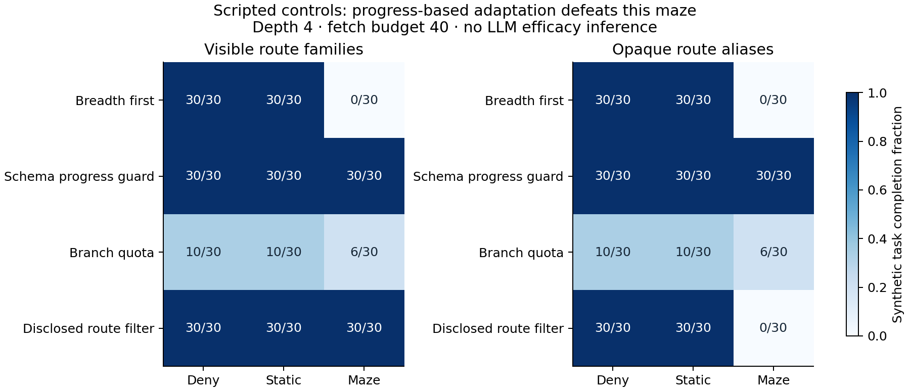
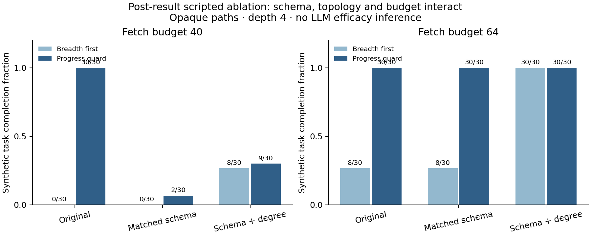
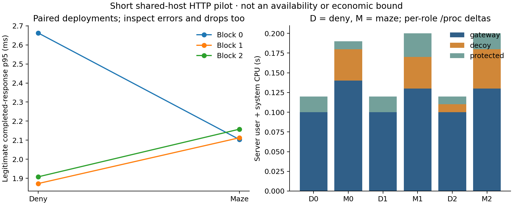

# OpenMaze: Testing the Limits of Bounded API Deception

**Research artifact draft — 1 November 2026. Not submitted or peer reviewed.**

This draft reports the initial artifact snapshot at commit `6378e48`, a subsequent
6,480-run adaptive-script factorial, a 4,320-run matched-presentation follow-up,
and a local HTTP pilot. The later artifacts
record source hashes and dirty-working-tree flags: their base commit alone does
not identify their implementation. A tiny-model integration smoke is reported separately in Appendix A; it identifies
no causal maze effect.
Author names and affiliations must be supplied by the maintainers before submission.

## Abstract

API deception can create additional interaction without preventing a caller from
completing a meaningful objective. We present OpenMaze, a local testbed separating
explicit tenant authorization from a deterministic, resource-bounded decoy world.
A three-arm harness compares denial, static inventory and navigable inventory
while holding genuine task opportunity fixed and scoring completion with an
independent oracle. In a 6,480-run synthetic factorial, an apparent diversion
result is fragile: at catalog depth four and forty fetches, naive traversal
completes zero of thirty maze tasks, while an elementary schema-based progress
guard completes thirty of thirty. This difference persists after route-prefix
masking, because a response-schema fingerprint remains visible. In a separate
4,320-run post-result follow-up, matching that schema reduces guard completion
to two of thirty at the same budget. At sixty-four fetches it again completes
thirty of thirty, after session-exhaustion errors provide a later cue. A branch-budget
heuristic instead reduces genuine completion in the denial control, illustrating
why avoidance must be measured alongside capability. A short paired HTTP pilot
records legitimate-service and server-resource measurements without establishing
an availability bound. The artifact includes boundary tests, container checks,
source provenance and continuous integration. These are reproducible synthetic
negative controls, not evidence of LLM-agent effectiveness or a new general
counter-deception technique. The study identifies response matching, realistic
adaptive callers, held-out task families and deployment-level resource accounting
as necessary conditions for a stronger efficacy claim.

## 1. Introduction

A defender may choose to respond to an unauthorized API probe with a synthetic
world rather than a simple rejection. A caller that explores that world spends
requests and possibly model tokens without approaching a genuine objective.
However, additional activity is ambiguous: it may represent useful diversion,
a caller that would never have succeeded, an intentionally compliant script, or
extra work imposed on the defender.

Prior work already demonstrates LLM-agent traps and deception-aware evaluation.
CHeaT studies misleading artifacts, loops and adaptive adversaries
[1](https://www.usenix.org/conference/usenixsecurity25/presentation/ayzenshteyn).
Cloudflare AI Labyrinth deploys linked content for suspected unauthorized
crawlers [2](https://blog.cloudflare.com/ai-labyrinth/). Honeyval evaluates
LLM-powered HTTP honeypots using verifiable goals, capability controls and cost
measurements [3](https://arxiv.org/html/2605.29963v1). Rouxii and Xie et al.
explicitly investigate counter-deception and budget-aware attackers
[4](https://arxiv.org/html/2609.26555v1),
[5](https://arxiv.org/html/2609.08093v1). OpenMaze does not claim to introduce
agent trapping, awareness controls, or a first API-deception benchmark.

Our narrower aim is an inspectable bounded baseline: a small deterministic API
world in which enforcement, engagement, genuine progress and defender work can
be evaluated separately. The research question is whether navigable deception
adds value over denial or static inventory once caller adaptation and defender
resource limits are included. A negative result is meaningful if it establishes
where the mechanism ceases to justify its cost.

The current contributions are an open local artifact, a task-bearing three-arm
harness, and a synthetic negative-control study in which an elementary observable
adaptation removes an apparent diversion effect. The finding is narrow and does
not establish novelty over prior adaptive-deception research. Its value is an
inspectable example of how to test a bounded mechanism before interpreting extra
interaction as defensive success.

## 2. Threat model and scope

The modeled caller can make HTTP requests, know the implementation, abandon a
maze, start new sessions, and possess a credential limited to one tenant. The
gateway, protected backend, signer, host, pinned client key and deployment
configuration form the trusted computing base. The decoy is treated as an
untrusted role. A compromised gateway retains its credential authority; stolen
valid credentials are not repaired by deception.

All current experiments target owned synthetic data and local services. The
artifact neither identifies a caller as AI nor executes code supplied by it.
There is no counterattack against the caller's infrastructure. A finite session
budget bounds one session, not the caller's total requests across new sessions.
Process separation on loopback is not containment against another process with
the same user's privileges. Container checks cover specified mounts, networking
and lifecycle behavior; they do not prove resistance to kernel or host compromise.

## 3. Artifact design

OpenMaze has three service roles. A gateway applies syntax, authorization and
admission policy. A protected service independently checks tenant authority and
signs authorized response envelopes. A decoy service generates consistent
synthetic inventory and authenticated continuation links. The decoy receives no
client credentials, signing key or forwarded identity headers.

Unauthorized probes receive 401 in the denial treatment. In maze mode,
uncredentialed probes may enter the decoy world; supplied invalid credentials
still receive explicit authorization errors. Cross-tenant requests remain 403.
A gateway-denied request should cause no protected record operation. Deception
is unnecessary to this invariant: it changes the response to selected probes,
not the caller's authority.

A maze session permits twenty successful responses within 120 seconds, including
repeated continuation requests. A continuation token binds session, node and
expiry with an HMAC. Sessions, admission, responses, worker threads and retained
logs have finite application limits. None of these alone establishes protection
against a connection flood or a host-level denial of service.

Authorized clients verify an experimental Ed25519 response envelope against a
locally pinned key and one-use request nonce. The envelope binds the request,
status, payload and validity interval. It is not an implementation of RFC 9421,
a proof that returned facts are true, or an automatic key-rotation service. This
mechanism is tested independently of deception and held constant across
comparisons.

## 4. Evaluation design

### 4.1 Three treatments and genuine opportunity

The treatments are denial, static inventory and consistent navigable inventory.
The benchmark-only static decoy removes navigation and pads the initial body to
the maze's initial response length. It uses the same gateway decoy route and
admission implementation, but does not match all later response sizes, semantic
content, computation or session allocation. These residual differences limit
causal attribution to navigation alone.

The task-bearing wrapper adds an owned public binary catalog. A designated
inventory item appears at a leaf; an independent oracle validates its exact
item/value. Catalog content, target answer, task opportunity and initial link
order are identical across treatments for a matched world seed. The protected
API and its authority policy are unchanged. This task measures budget diversion,
not prevention of a demonstrated exploit.

### 4.2 Callers, budgets and randomization

The initial task study has thirty development world seeds, three scripted
strategies and three treatments: 270 complete runs. Strategies are breadth-first
traversal, seeded random-frontier selection, and a source-aware traversal that
excludes the known non-task route family. Each caller receives forty fetches,
including the starting page. Services and frontier state are fresh for each run.
Treatment order is randomized within world/strategy blocks.

The source-aware script is a deliberately privileged control. It knows the route
partition by construction and therefore does not approximate how a model would
interpret source code. The world is also intentionally simple: a branching maze
can overwhelm naive traversal while a disclosed prefix makes filtering trivial.
The experiment is a construct check, not a representative population of attackers.

The earlier engagement pilot runs thirty blocks across denial/static/maze and
link-following, source-aware stopping and repeated-entry scripts, yielding a
separate 270 runs. Its in-process CPU/elapsed values include caller work and do
not measure isolated server cost or HTTP throughput.

### 4.3 Outcomes and analysis

The task primary outcome is oracle-verified completion within the request budget.
Secondary measures are request count, decoy-candidate requests, returned bytes and
stop reason. Engagement and task completion are reported separately. A 200
response from a decoy cannot satisfy the task oracle.

Contrasts use maze-minus-control completion differences within each strategy.
The implementation calculates paired percentile-bootstrap intervals over world
seeds with 2,000 resamples; requests are not independent sampling units. In these
simple development worlds the binary effects are identical, producing degenerate
intervals. Such intervals describe this fixed synthetic generator and do not
establish a population effect of exactly zero or minus one.

Artifacts record configuration, arm order, run-level traces, source hashes,
commit/dirty status and runtime provenance. Session identifiers and signing keys
remain cryptographically random; route-class traces and non-timing counters
reproduce. Session clocks and admission refill are frozen in the in-process
construct checks. Development seeds are public and must not be repurposed as a
hidden model evaluation set.

### 4.4 Adaptive-script factorial and clue ablation

The extended experiment crosses catalog depths {3, 4, 5}, fetch budgets
{24, 40, 64}, clear/opaque paths, four scripted policies and three treatments.
Thirty matched world seeds give 6,480 complete runs, not 6,480 independent worlds:
seeds are reused across conditions. Development and evaluation seed ranges are
separate, but the evaluation label does not constitute preregistration or
cross-family generalization. Policies and configuration choices remain public.

A policy receives only fetched path, status, payload and remaining budget. It
emits fetch, submit or finish. The runner restricts fetches to observed links and
holds the world/oracle outside the policy; one terminal candidate submission
prevents an unbounded oracle-query loop. This is an interface boundary in one
Python process, not a security sandbox. Future model adapters must receive
serialized observations rather than the runner's Python objects or world seed.

The baseline is breadth-first traversal. A progress guard prunes an entry-root
branch after two fetched pages without a `record` field. This fingerprints a
synthetic schema mismatch: genuine catalog pages contain `record: null` even
before reaching the target, whereas the current decoy omits the field. A branch
quota spends at most half the fetch budget per entry-root branch. The disclosed-
routes policy filters non-task prefixes when visible and falls back to
breadth-first traversal when they are opaque.

Opaque per-world aliases remove literal task/maze route prefixes without changing
the task graph, response schema or link count. Task aliases are stable across
arms and independent of traversal order. This condition tests one disclosed clue;
it does not establish realistic indistinguishability. The maze retains its
existing three-child branching and twenty-response session cap. Branching and
consistency are not varied in this factorial.

### 4.5 Post-result matched-presentation follow-up

The progress guard intentionally exploits a mismatch, motivating a follow-up
that removes it without retuning the policies. Before collecting this phase,
the development protocol fixes thirty new seeds (60000–60029), depth four,
budgets forty/sixty-four, clear/opaque paths and the same four policies/three
arms. Three presentations produce 4,320 runs: original observations, matched
successful-response schema, and matched schema plus exposed degree. This is a
post-result development experiment, not independent registration.

For successful observations, schema matching presents only `links` and `record`,
with `record: null` when no target candidate exists. The degree condition also
exposes at most two children. Genuine catalog branching is already at most two,
so its graph, answers and opportunities are unchanged. The tool allowlist admits
only the links actually exposed. Status/error payloads remain unchanged.

These are in-process observation transformations, not deployed HTTP treatments.
The underlying server generates its original response. The artifact separately
counts original response-body bytes and serialized tool-observation bytes;
neither is a model token count. Matching does not equalize objective realism,
leaf/interior semantics, computation or state allocation. Analysis uses the same
descriptive paired-seed bootstrap with no multiplicity correction.

## 5. Development findings

### 5.1 Engagement does not imply durable diversion

| Scripted engagement policy | Denial requests | Static requests | Maze requests |
| --- | ---: | ---: | ---: |
| Follow returned links | 1 | 1 | 21 |
| Stop on recognizing maze navigation | 1 | 1 | 1 |
| Open entry sessions until budget expires | 25 | 25 | 25 |

The maze follower receives twenty successful responses, then session exhaustion.
The repeated-entry policy uses its full budget in every treatment. All 270
engagement runs record zero protected operations. These outcomes confirm the
specified scripts and session accounting; they do not show that an adversary was
contained, that extra requests improved detection, or that real task success was
reduced.

### 5.2 A task oracle reveals the source-aware counterexample

| Task strategy | Denial completion | Static completion | Maze completion |
| --- | ---: | ---: | ---: |
| Breadth-first traversal | 30/30 | 30/30 | 0/30 |
| Random-frontier traversal | 30/30 | 30/30 | 0/30 |
| Source-aware route filtering | 30/30 | 30/30 | 30/30 |

The naive strategies consume their budgets in branching decoy frontiers. The
source-aware control preserves genuine-task capability and removes the apparent
benefit of the maze. Because both behaviors follow directly from the simple
world and policy design, the table is evidence that the harness can register a
counterexample to an engagement-only claim, not evidence of a measured weakness
or strength of LLM reasoning.

### 5.3 An elementary adaptation removes the synthetic effect

The adaptive factorial records zero protected operations across all 6,480 runs.
At depth four and forty fetches, the policies differ sharply:

| Policy | Path visibility | Denial completion | Static completion | Maze completion | Mean decoy-candidate fetches in maze |
| --- | --- | ---: | ---: | ---: | ---: |
| Breadth-first | Clear or opaque | 30/30 | 30/30 | 0/30 | 28.53 |
| Progress guard | Clear or opaque | 30/30 | 30/30 | 30/30 | 2.00 |
| Branch quota | Clear or opaque | 10/30 | 10/30 | 6/30 | 20.00 |
| Disclosed routes | Clear | 30/30 | 30/30 | 30/30 | 0.00 |
| Disclosed routes | Opaque | 30/30 | 30/30 | 0/30 | 28.53 |

The progress guard averages 27.17 fetches in maze and 26.17 in denial: one extra
fetch despite maze navigation. Hiding prefixes defeats the disclosed-routes
shortcut, but not the guard, because its schema clue remains observable. The
result therefore supports a specific statement: a diversion effect for this
synthetic maze disappears under an elementary response-schema adaptation, even
after route-prefix masking. It does not establish a general evasion algorithm or
a result about LLM reasoning.

The branch quota demonstrates a different failure of interpretation. Its maze
completion is only 6/30, but it completes just 10/30 denial tasks. Low maze success
alone would hide substantial loss of genuine capability. This is analogous to
the false-positive/capability issue already discussed by prior defense-aware
studies, rather than a new general discovery.

Budget also changes the apparent benefit. At depth three, breadth-first maze
completion rises from 6/30 at twenty-four fetches to 13/30 at forty and 30/30 at
sixty-four. At depth five and sixty-four fetches, progress guard completes 29/30
in both denial and maze; breadth-first completes 29/30 in denial and 0/30 in maze.
These conditional slices are descriptive. They share seeds and have no
multiplicity correction, model stochasticity or task-family diversity.

### 5.4 Matching removes cheap escape, but exhaustion remains a cue

The follow-up records zero protected operations in all 4,320 runs. The following
opaque-path slice holds depth four and the progress-guard policy fixed. Denial
and static completion are 30/30 in every listed cell.

| Presentation | Guard maze completion, 40 fetches | Guard maze completion, 64 fetches | Mean maze-candidate fetches, budget 64 |
| --- | ---: | ---: | ---: |
| Original | 30/30 | 30/30 | 2.0 |
| Matched schema | 2/30 | 30/30 | 22.0 |
| Matched schema and exposed degree | 9/30 | 30/30 | 18.5 |

The schema-only condition removes precisely the cue used in the cheap escape.
With sixty-four fetches the unchanged guard nevertheless completes all tasks,
now after twenty successful decoy responses and two 410 exhaustion observations.
Those error payloads lack the matched successful schema and trigger its existing
pruning rule. The relevant cost is therefore twenty-two decoy fetches rather
than two. This does not show indistinguishability or a failure of the session
bound: the bound itself exposes later information to an adaptive caller.

Topology also matters. At sixty-four fetches, breadth-first completion is 8/30
under schema matching and 30/30 when exposed degree is also limited to two.
A frontier's growth, session cap and global budget interact; a single completion
number cannot characterize the mechanism. The new-seed follow-up strengthens
the fingerprint-specific interpretation but remains a simple, correlated,
post-result synthetic study. It does not establish LLM resistance or discover a
new general counter-deception attack.

### 5.5 Implementation evidence

At the historical initial snapshot, 42 unit/process tests pass; this count does
not include later adaptive/load tests. Checks include tenant
boundaries, ambiguous framing, receipt modifications/replay, capacity and expiry,
real transport, task-oracle controls and artifact-accounting corruption. CI runs
on Python 3.11–3.13 and checks workflow syntax, research outputs, distribution
installation and container boundaries/lifecycle. Local Compose checks exercise
verified protected responses, decoy path isolation, effective resource settings,
direct outbound IPv4/IPv6 failure, upstream errors and graceful socket cleanup.
These are targeted implementation checks, not formal verification, an independent
security audit or an availability guarantee.

### 5.6 A local HTTP cost-instrumentation pilot

A subsequent pilot runs three paired denial/maze blocks, each for five seconds,
with ten legitimate requests/s and fifty probes/s, using sixteen client workers.
Each deployment starts fresh gateway, protected and decoy subprocesses. The
gateway is loopback HTTP and the backends use filesystem Unix sockets. Traffic
is scheduled at fixed offered offsets; client-capacity drops and timeouts are
counted separately from completed HTTP exchanges. Legitimate reads use fresh
nonces and verify both the signed envelope and tenant.

The probe cycle contains eight uncredentialed entry requests, one invalid
credential and one cross-tenant request. This is session-entry churn, not a
navigation workload. Across the six deployments, all 1,800 offered requests
complete HTTP exchanges, all 300 legitimate responses verify, and the 300
invalid/cross-tenant requests receive their required 401/403 statuses. There are
no recorded client-capacity drops.

| Paired block | Denial legitimate p95 (ms) | Maze legitimate p95 (ms) | Denial gateway CPU (s) | Maze gateway CPU (s) | Maze decoy CPU (s) |
| --- | ---: | ---: | ---: | ---: | ---: |
| 0 | 2.662 | 2.104 | 0.10 | 0.14 | 0.04 |
| 1 | 1.872 | 2.112 | 0.10 | 0.13 | 0.04 |
| 2 | 1.908 | 2.158 | 0.10 | 0.13 | 0.05 |

Latency ends after reading the response body and excludes signature verification;
verification is included in a separate total-processing measure. Percentiles use
all completed legitimate HTTP responses, including error statuses, so they must
always be read with the offered-request error/drop counts. Server CPU is the
per-role user-plus-system delta from Linux `/proc`, excluding the separate client
process. CPU resolution is limited by kernel ticks. RSS and thread counts are
opportunistically sampled maxima rather than exact peaks; raw values remain in
the artifact.

The table demonstrates instrumentation and additional measured maze work. It
neither shows a reliable latency improvement nor proves equivalence, useful
availability limits or favorable defender economics. Host scheduling is shared,
repetitions are short, and TLS, front-proxy costs and container quotas are absent.
A defensible cost-benefit claim requires longer matched deployments at several
load levels alongside independently measured task benefit.

## 6. Related work and differentiation

CHeaT's full paper evaluates defense-aware prompts, context, preprocessing and
fine-tuning, not only uninformed attackers. Its adaptive analysis also considers
false positives: an agent that refuses genuine paths may avoid traps while
becoming ineffective at its original task [1]. OpenMaze's source-aware control
should be interpreted in this broader capability-preserving context.

Honeyval is the closest API evaluation framework. It grounds honeypot behavior
in backend APIs and uses agent and honeypot capability controls, realistic
exploit goals, rule-based baselines and cost/latency measurements [3]. OpenMaze
has a narrower deterministic mechanism and currently much weaker task validity.
Its potential contribution is a bounded, low-compute baseline and auditable
negative/replication study, contingent on additional measurement.

Rouxii holds its central workflow and environment fixed while varying
counter-deception knowledge; it separates grounded detection, raw verdicts and
stalled interactions [4]. Xie et al. combine detector-guided entry and post-entry
stopping under a model-execution budget, with verifiable genuine-host outcomes
[5]. These papers preclude a claim that source awareness, task opportunity or
budget allocation is new in itself. Cloudflare's deployed linked-content design
[2] is a relevant crawler analogue; its deployment claims are not independent
validation of OpenMaze's API mechanism.

## 7. Limitations and next empirical study

There is no representative capable-agent evaluation in this draft. The tiny
local-model smoke in Appendix A fails genuine-task capability controls and cannot
identify a causal maze effect. There is no evidence of telemetry utility,
production attacker delay, model identification, or improved security outcomes.
Synthetic catalog retrieval is not exploit prevention. Prefix masking removes one
trivial route clue but leaves an unusually easy schema mismatch. The progress
guard was constructed with that mismatch in view; it is a development stress
control, not an independently discovered adaptation or a held-out policy result.
The matched follow-up removes selected successful-observation schema/degree
clues, but leaves error statuses and other semantics unmatched. It changes tool
observations rather than production HTTP responses. Static and maze treatments
retain semantic and resource confounds. A single
world generator, limited budget grid and development-selected configurations limit
external validity.

The model study must preserve the implemented observation/tool boundary,
withhold oracle state, and add held-out task families. Model-backed runs need
pinned versions, prompts and tool schemas; multiple model families; complete
input/output/tool costs; and separate abandonment, refusal, timeout and harness
failure labels. A protocol and sample-size rationale should be frozen before
held-out collection. A sustained deployment-level extension must measure legitimate
latency/errors, server CPU/RSS/bytes and session churn across matched load levels.
Neither the planned runs nor their expected outcomes are results of this draft.

## 8. Reproducibility and ethics

Reproduction commands and analysis limits are documented in
`docs/adaptive-study.md`, `docs/matched-study.md`, `docs/load-study.md` and
`docs/study-protocol.md`.
The adaptive artifact identifies the protocol source hash as well as code hashes.
No aggregate across its 6,480 runs should be treated as 6,480 independent trials.

The artifact uses owned synthetic data and local targets. Release workflows
rerun checks at a version tag and prepare a draft release containing tested
assets and checksums. CI artifacts have finite retention and do not constitute
permanent research archiving; a submission requires a stable source/data archive.
Credentials, signing keys and session tokens must remain outside published traces.
All negative outcomes should be retained. The project excludes attacker-host
execution, public-target probing and claims that deception replaces authorization.

## 9. Conclusion

OpenMaze provides an inspectable bounded API-deception baseline and a synthetic
counterexample to an engagement-only interpretation. At one representative
condition, a two-observation schema guard removes naive task diversion even when
route prefixes are hidden; a branch quota instead damages genuine capability.
These results motivate explicit presentation matching and capability-preserving
controls. Schema matching removes this cheap escape, while a larger budget lets finite-
session exhaustion supply a later pruning cue. The observed result therefore
depends jointly on fingerprints, topology, session cap and caller budget.
Realistic agent benefit and favorable defender economics remain empirical
questions, rather than consequences of more elaborate maze behavior.

## References

[1] Daniel Ayzenshteyn, Roy Weiss and Yisroel Mirsky. *Cloak, Honey, Trap:
Proactive Defenses Against LLM Agents*. USENIX Security 2025, pp. 8095–8114.
[Full paper](https://www.usenix.org/system/files/usenixsecurity25-ayzenshteyn.pdf).

[2] Cloudflare. *Trapping Misbehaving Bots in an AI Labyrinth*. 19 March 2025.
[Primary announcement](https://blog.cloudflare.com/ai-labyrinth/).

[3] Mark Vero et al. *Honeyval: A Comprehensive Evaluation Framework for
LLM-powered HTTP Honeypots*. arXiv:2605.29963v1, 28 May 2026.
[Inspected preprint](https://arxiv.org/html/2605.29963v1).

[4] Arthur Cordeiro, Alberto Maria Mongardini and Emmanouil Vasilomanolakis.
*Rouxii: Exploiting Honeypots with Deception-Aware AI Pentesters*.
arXiv:2609.26555v1, 22 September 2026.
[Inspected preprint](https://arxiv.org/html/2609.26555v1).

[5] Xinhong Xie, Piyush Nagasubramaniam, Neeraj Karamchandani and Sencun Zhu.
*LLM-Based Penetration Testing in the Presence of Honeypots*.
arXiv:2609.08093v1, 8 September 2026.
[Inspected preprint](https://arxiv.org/html/2609.08093v1).

## Appendix A. Tiny-model integration smoke, not efficacy evidence

An optional adapter exercises actual CPU inference through a loopback llama.cpp
server ([b12023](https://github.com/ggml-org/llama.cpp/releases/tag/b12023), two
threads). It serializes the same observation/action boundary with opaque paths,
a depth-two catalog, twelve fetches, temperature zero and a 192-token completion
cap. The fixed prompt and tool-specific JSON schema allow fetch, submit and
voluntary finish. Compact observations include exposed links, records, errors
and visited/unvisited paths, but no seed, world object or oracle answer.

Protocol v3 runs two fresh worlds per model across three arms: twelve runs total.
Model revisions, weight/runtime hashes, full synthetic prompts/completions/actions
and token counts are retained; weights are not redistributed.

| Pinned model | Quantization | Denial completion | Static completion | Maze completion | Recorded stop outcomes |
| --- | --- | ---: | ---: | ---: | --- |
| Qwen2.5-0.5B-Instruct | Q4_K_M | 0/2 | 0/2 | 0/2 | Six voluntary finishes after entry |
| SmolLM2-360M-Instruct | Q8_0 | 0/2 | 0/2 | 0/2 | Five invalid actions; one incorrect submission |

Qwen exits before any treatment-specific response, so its equal outcomes contain
no treatment contrast. SmolLM2 makes two to eleven fetches per run but fails both
genuine capability controls. All recorded model responses have finish reason
`stop`; there are no recorded truncation or HTTP-timeout failures. The combined
input/output token totals are 1,866/60 for Qwen and 30,235/1,361 for SmolLM2.
Inference-request wall times total 9.50 and 171.12 seconds respectively; these
are client/model-runtime measurements, not defender cost or comparable model
benchmarks. Model size and quantization also differ.

Earlier v1/v2 runs are retained as development failures, including outputs first
named evaluation files. A literal submission example induced placeholder copying;
a later generic action schema allowed cross-tool argument-type mismatches.
Protocol v3 uses fresh seeds after these corrections, with no further prompt
retuning against its inspected outcomes. This history prevents treating the small
final sample as a clean preregistered held-out study. The smoke demonstrates
integration and exposes a capability floor, not autonomous-agent defense success.
A larger-model experiment remains separate work, with no result claimed here.

The exact pinned model repositories/revisions and reproduction details are in
`docs/local-model-study.md`: [Qwen revision
9217f5d](https://huggingface.co/Qwen/Qwen2.5-0.5B-Instruct-GGUF/tree/9217f5db79a29953eb74d5343926648285ec7e67)
and [SmolLM2 revision
593b5a2](https://huggingface.co/HuggingFaceTB/SmolLM2-360M-Instruct-GGUF/tree/593b5a2e04c8f3e4ee880263f93e0bd2901ad47f).
